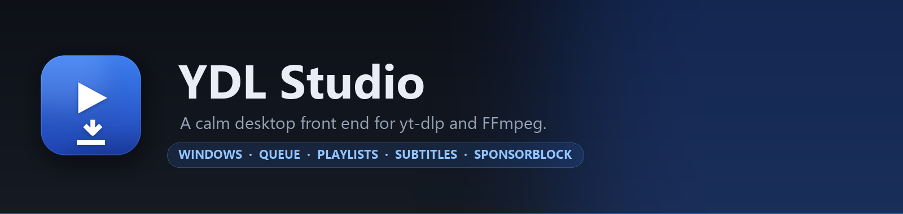
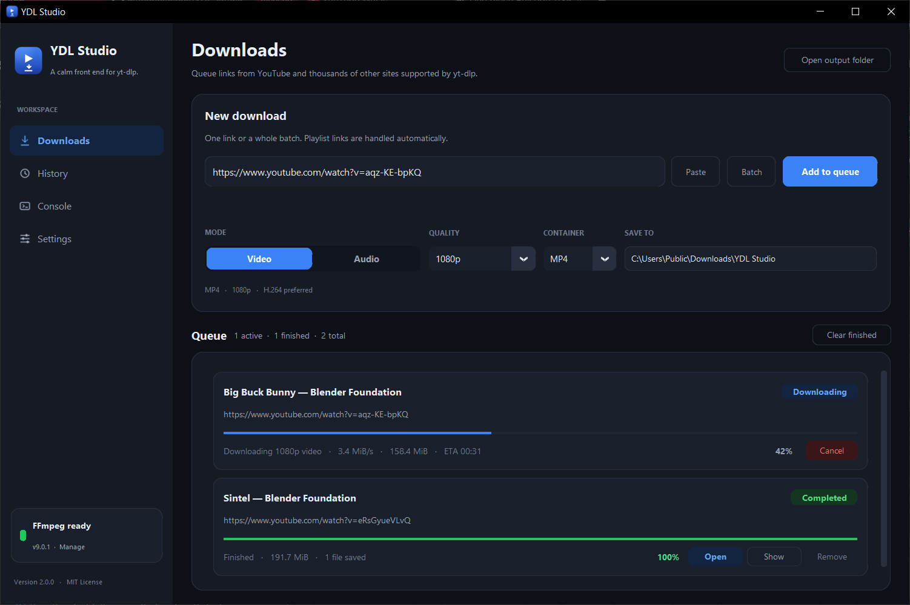
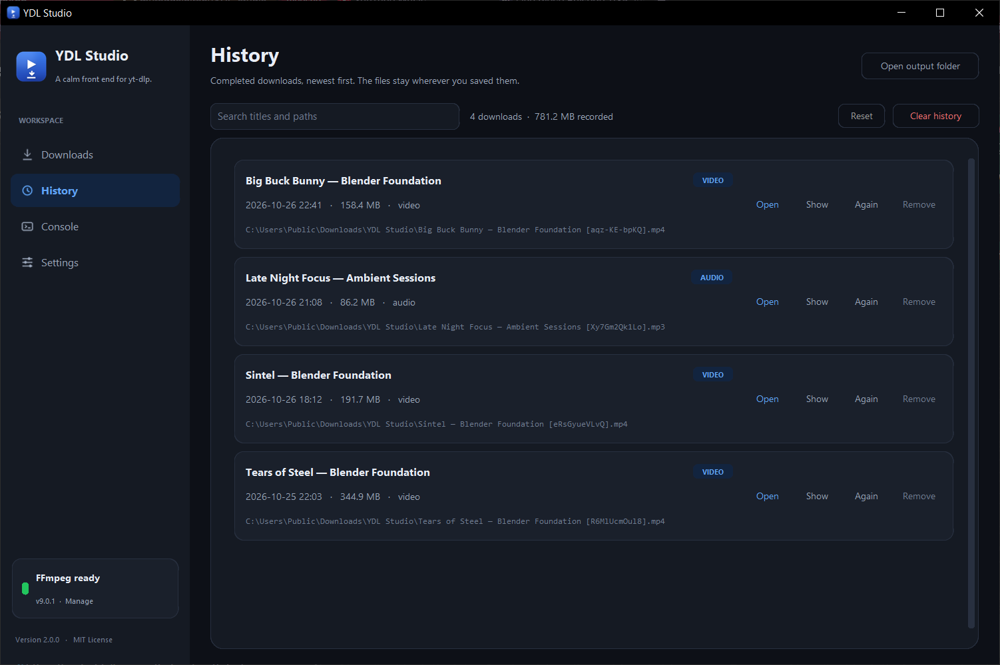
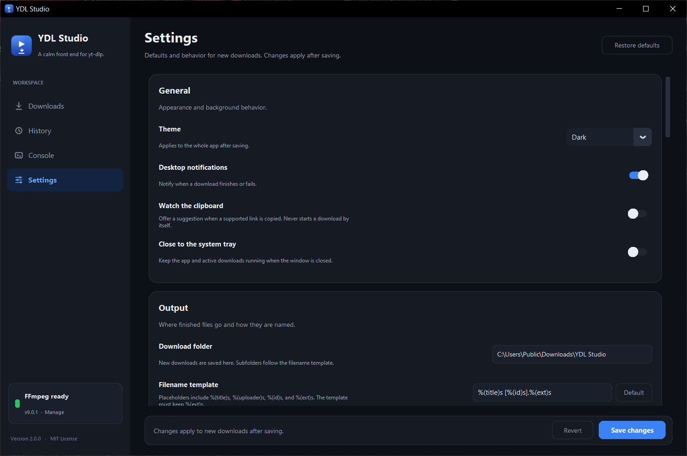
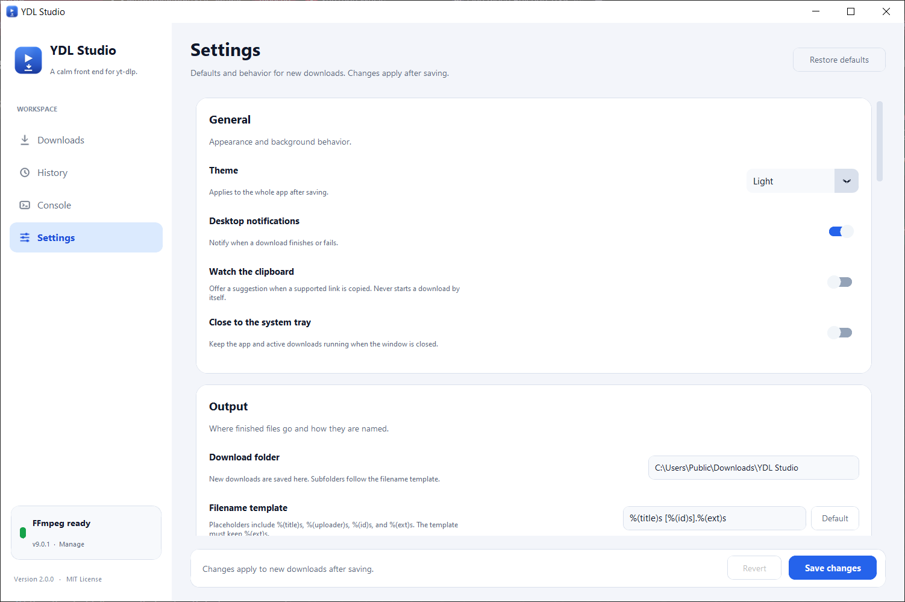

<div align="center">
  <a href="https://github.com/mufaddalhirani/YDL-studio">
    
  </a>

  <p>
    <a href="https://github.com/mufaddalhirani/YDL-studio/blob/main/LICENSE"></a>
    <a href="https://github.com/mufaddalhirani/YDL-studio/releases/latest"></a>
    <a href="https://github.com/mufaddalhirani/YDL-studio/actions/workflows/ci.yml"></a>
    
    
  </p>

  <p>
    A desktop app for yt-dlp with a queue, batch downloads, playlists, subtitles,
    SponsorBlock, history and a system tray — without touching a terminal.
  </p>
</div>

---

yt-dlp is the best downloader there is, but it asks you to remember flags. YDL Studio
keeps yt-dlp doing the work and moves the options into a window you can actually read:
paste a link, choose a quality, press **Add to queue**, and get on with your day.

Everything is local. There is no account, no telemetry, and no service between you and
the site you are downloading from.

## See it

| Downloads | History |
| --- | --- |
|  |  |

| Settings | Light theme |
| --- | --- |
|  |  |

Screenshots are from version 2.0.0 on Windows 10 at 125% scaling. The demo entries use
Blender's open movies.

## Features

**Queue and batch**
- Add one link or paste a hundred at once — the batch dialog parses, previews and de-duplicates them.
- Jobs run one at a time so a playlist does not saturate your connection; each row shows progress, speed, size and ETA.
- Cancel a running job, retry a failed one, remove or clear finished ones.
- Links copied while the app runs are offered as a suggestion — never started on their own.

**Format control**
- Video up to 2160p (4K) with an MP4 or MKV container and an optional H.264 preference for
  devices that stumble over VP9/AV1.
- Audio-only extraction to MP3, M4A, FLAC, WAV or Opus at 128–320 kbps.
- Playlists with an item range, so `2-8,11` is enough to grab the tracks you want.

**Media extras**
- Embed thumbnails, metadata and chapter markers.
- Subtitles in chosen languages, embedded or as sidecar `.srt` files, with auto-generated captions as an option.
- SponsorBlock support to mark sponsor segments as chapters or cut them out entirely.
- Cookies from an installed browser (Chrome, Edge, Firefox, Brave, Opera, Vivaldi,
  Chromium, Safari) or a `cookies.txt` file, for age-gated and private videos.
- Optional rate limiting and a field for any extra yt-dlp argument.

**Around the edges**
- History with search, plus open, reveal in Explorer, and re-download actions.
- A live console that shows exactly what yt-dlp reported, useful when a site changes.
- System tray with balloon notifications, and an option to keep downloading after the
  window is closed.
- Dark, light and system themes that follow the moment you save the setting.
- FFmpeg auto-installer: the app fetches and verifies the official build for you.

## Install

### The easy way — portable executable

1. Download `YDL-Studio.exe` from the
   [latest release](https://github.com/mufaddalhirani/YDL-studio/releases/latest).
2. Put it anywhere you like — a folder, a USB stick, the desktop.
3. Double-click it.

Nothing is installed, no Python required. Windows SmartScreen may warn on first launch
because the build is unsigned; choose **More info → Run anyway**.

Every release attaches `YDL-Studio.exe.sha256.txt`. To check your copy:

```powershell
Get-FileHash .\YDL-Studio.exe -Algorithm SHA256
```

The printed hash should match the one in that file.

### From source

Needs Python 3.10 or newer.

```powershell
git clone https://github.com/mufaddalhirani/YDL-studio.git
cd YDL-studio

python -m venv .venv
.\.venv\Scripts\Activate.ps1

pip install -r requirements.txt
python -m ydl_studio
```

To get a `ydl-studio` command on your PATH instead:

```powershell
pip install .
ydl-studio
```

### Command line

```powershell
ydl-studio https://www.youtube.com/watch?v=aqz-KE-bpKQ   # start with links queued in the bar
python -m ydl_studio URL [URL ...]
ydl-studio --version
ydl-studio --help
```

## First run

**Where files go.** Downloads land in `Downloads\YDL Studio` — or the folder you pick in
**Settings → Output**. Relocated Windows Downloads folders are respected.

**FFmpeg.** Plain video downloads work without it. Merging separate video and audio
streams, extracting audio, embedding subtitles or thumbnails, writing chapters and
SponsorBlock all need FFmpeg. The sidebar tells you whether it was found, and
**Settings → FFmpeg → Install FFmpeg** fetches the official build into the app's own
folder. Manual setup works too: put `ffmpeg.exe` and `ffprobe.exe` on `PATH`, or beside
the app in a `bin` folder.

**Settings and history** are stored per user in `%APPDATA%\YDL Studio`
(`config.json`, `history.json`, `logs\`). Set `YDL_STUDIO_DATA_DIR` to keep them
elsewhere, which is handy for a portable install.

## Keyboard shortcuts

| Shortcut | Action |
| --- | --- |
| `Ctrl` + `1` … `4` | Jump to Downloads, History, Console, Settings |
| `Ctrl` + `N` | New download and focus the link field |
| `Enter` | Add the typed link to the queue |
| `Esc` | Clear the search field on the History page |

## Building the executable

```powershell
pip install -r requirements-dev.txt
pyinstaller scripts/YDL-Studio.spec --noconfirm
```

The result is `dist\YDL-Studio.exe` — one portable file with the Python runtime, the
icon and the bundled assets inside it. The spec is written for Windows; build it there.

## Development

```powershell
pip install -r requirements-dev.txt

pytest                     # unit tests plus an offline end-to-end download
ruff check ydl_studio scripts tests
python -m ydl_studio
```

The test suite never touches the network: an integration test serves a sample file from
a local HTTP server and drives the real download queue against it.

| Path | Purpose |
| --- | --- |
| `ydl_studio/app.py` | Window, navigation, tray and event pump |
| `ydl_studio/tabs.py` | Downloads, History and Console pages |
| `ydl_studio/settings_tab.py` | Settings form and FFmpeg installer |
| `ydl_studio/queue.py` | Sequential download manager over yt-dlp |
| `ydl_studio/options.py` | App settings → yt-dlp argument mapping |
| `ydl_studio/config.py` | Settings, history and data paths |
| `ydl_studio/ffmpeg.py` | FFmpeg discovery and installation |
| `ydl_studio/theme.py` | Colours, fonts, icons |
| `ydl_studio/widgets.py` | Reusable dialog and control building blocks |
| `ydl_studio/media.py` | URL parsing and metadata probes |
| `scripts/` | Frozen entry point, icon and banner generators, PyInstaller spec |

## Troubleshooting

| Symptom | What to do |
| --- | --- |
| `Video unavailable` / `Sign in to confirm` | Enable cookies from your browser in **Settings → Cookies and network**, then retry |
| Download is slow or stalls | Lower the quality, or turn off *Prefer H.264* so yt-dlp can use the native format |
| Audio conversion or merging fails | Install FFmpeg from **Settings → FFmpeg** |
| Playlist only grabs one video | Turn on *Download full playlists* in **Settings → Playlists**, optionally with an item range |
| SmartScreen blocks the app | Expected for an unsigned build — **More info → Run anyway** |
| A site that used to work now errors | Update yt-dlp (`pip install -U yt-dlp`); sites change often and the fix is usually upstream |
| Need the raw logs | **Settings → Output → Folders → Logs**, and paste the tail into an issue |

## Notes

- YDL Studio is an independent front end for yt-dlp and is not affiliated with yt-dlp,
  FFmpeg or any streaming site.
- Downloading content you do not have the rights to may violate a site's terms or your
  local law. Use it for your own files, licensed material and content whose terms allow it.
- Supported sites are exactly the ones yt-dlp supports — see the
  [yt-dlp supported sites list](https://github.com/yt-dlp/yt-dlp/blob/master/supportedsites.md).

## Credits

- [yt-dlp](https://github.com/yt-dlp/yt-dlp) — the downloader
- [FFmpeg](https://ffmpeg.org/) — the media backend
- [CustomTkinter](https://github.com/TomSchimansky/CustomTkinter) — the widget set
- [pystray](https://github.com/moses-palmer/pystray) — system tray

## License

Released under the [MIT License](LICENSE) by Mufaddal Hirani.
